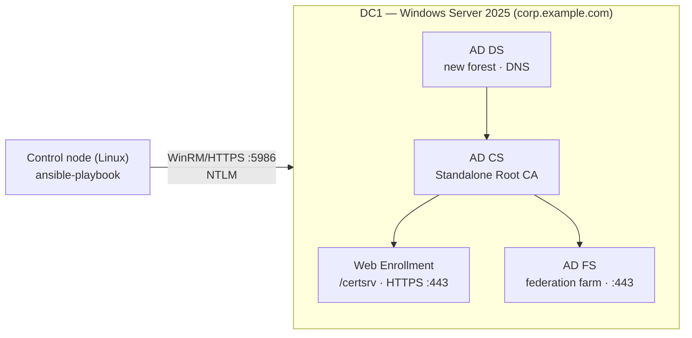

# Ansible — Windows Server 2025 AD DS + AD CS + AD FS

[](https://docs.ansible.com/)
[](https://www.microsoft.com/windows-server)
[](LICENSE)

Renames a fresh **Windows Server 2025** host to **DC1**, promotes it to the first
domain controller of a **new AD forest**, installs **AD CS** as a **Standalone
Root CA** with the **Web Enrollment** site (`/certsrv`) over HTTPS, then stands
up **AD FS** (Active Directory Federation Services) as the first node of a new
federation farm.

Connection: **WinRM over HTTPS** (pywinrm, NTLM).

> [!WARNING]
> **Lab environment — not production-hardened.** This build takes deliberate
> shortcuts for convenience: a **Standalone Root CA co-located on the DC**,
> **self-signed certificates** (WinRM and the lab Root CA), **AD FS on the DC**,
> **example domain/credentials**, and `ansible_winrm_server_cert_validation:
> ignore`. Secrets are kept in an **Ansible Vault** (not plaintext), but the
> shipped example passwords are weak placeholders. Do not point this at anything
> you care about — see [Notes](#notes) for the production caveats.

## Architecture

A single Windows Server 2025 host (`DC1`) stacks every role; the Linux control
node drives it over WinRM/HTTPS. In production these roles would be split across
dedicated servers (see [Notes](#notes)).



## Topology

| Hostname | IP | OS | Roles | Ports |
| --- | --- | --- | --- | --- |
| `DC1` (`dc01`) | `192.168.122.2` | Windows Server 2025 | AD DS, DNS, AD CS (Standalone Root CA), Web Enrollment, AD FS | 5986 (WinRM/HTTPS), 443 (AD FS + `/certsrv`), 53 (DNS), 389/636 (LDAP/LDAPS), 88 (Kerberos) |

> Lab defaults. Change the address in `inventory/hosts.yml` and the names/domain
> in `group_vars/windows_dc/ad.yml` (see [Configure](#configure)).

## Layout

```
ansible.cfg                     # config (points at inventory, collections, vault pass)
requirements.yml                # Galaxy collections to install
inventory/hosts.yml             # target host(s)
group_vars/windows_dc/
  connection.yml                # WinRM connection settings
  ad.yml                        # AD DS + AD CS + AD FS variables
  vault.yml.example             # secrets template -> copy to vault.yml (encrypted)
roles/ad_ds/                    # rename host + feature install + new-forest promotion
roles/ad_cs/                    # feature install + Standalone Root CA config
roles/adcs_web/                 # Web Enrollment (/certsrv) over HTTPS
roles/ad_content/               # OUs, groups, users (data-driven)
roles/ad_cert_request/          # request + install a web-server cert from the CA
roles/adfs/                     # feature install + first federation farm node
files/bootstrap-winrm.ps1       # run once ON the Windows host to enable WinRM
site.yml                        # main playbook
ping.yml                        # connectivity check
verify.yml                      # read-only post-build health check
.ansible-lint                   # lint config (production profile)
```

## Prerequisites

### Control node (this Linux box)

```bash
# Python WinRM client
python3 -m pip install --user "pywinrm>=0.4.3"

# Ansible collections (installed into ./collections, per ansible.cfg)
ansible-galaxy collection install -r requirements.yml -p collections
```

Collections used (see `requirements.yml` for pinned minimums):
`ansible.windows`, `microsoft.ad`, `community.windows`.

### Windows Server 2025 host

A fresh install with a reachable static IP and a local **Administrator** password.
Open an elevated PowerShell and run the bootstrap script (copy its contents, or
transfer the file):

```powershell
# from files/bootstrap-winrm.ps1
```

This enables an HTTPS WinRM listener on port 5986.

## Configure

1. Edit `inventory/hosts.yml` — set `ansible_host` to the server's IP.
2. Edit `group_vars/windows_dc/ad.yml` — computer name (`ad_hostname`, default
   `DC1`), domain name, NetBIOS, CA common name, etc.
3. Create the secrets file and encrypt it:

   ```bash
   cp group_vars/windows_dc/vault.yml.example group_vars/windows_dc/vault.yml
   # edit real passwords (12+ chars, meet Windows complexity), then:
   ansible-vault encrypt group_vars/windows_dc/vault.yml
   # store the vault password so ansible.cfg can read it:
   echo 'your-vault-password' > .vault_pass && chmod 600 .vault_pass
   ```

   The vault holds three secrets:

   | Variable | Used for |
   | --- | --- |
   | `vault_admin_password` | Local **Administrator** password before promotion; becomes `CORP\Administrator` after promotion (one value covers both phases). |
   | `vault_safe_mode_password` | Directory Services Restore Mode (DSRM) password set during forest creation. |
   | `vault_user_default_password` | Initial password for the AD users created by the `ad_content` role. |

   > All three must meet the Windows complexity policy (12+ chars, 3 of 4
   > character classes) or promotion/user creation will fail.

   **Working with the vault** (after it's encrypted):

   ```bash
   ansible-vault view group_vars/windows_dc/vault.yml     # read without decrypting to disk
   ansible-vault edit group_vars/windows_dc/vault.yml     # edit in place
   ansible-vault rekey group_vars/windows_dc/vault.yml    # change the vault password
   ```

## Run

**Pre-flight checklist** — confirm each before the first run:

- [ ] `pywinrm` and the Galaxy collections are installed on the control node.
- [ ] The Windows host has a static IP and you ran `files/bootstrap-winrm.ps1` on it (HTTPS WinRM listener on 5986).
- [ ] `inventory/hosts.yml` points `ansible_host` at that IP.
- [ ] `group_vars/windows_dc/ad.yml` has your hostname, domain, NetBIOS, and CA name.
- [ ] `vault.yml` is created, filled with complexity-compliant passwords, and encrypted; `.vault_pass` exists (mode `600`).
- [ ] `ansible-playbook ping.yml` succeeds (WinRM auth works).

```bash
ansible-playbook ping.yml      # verify WinRM auth
ansible-playbook site.yml      # full build (AD DS then AD CS)

# just one phase:
ansible-playbook site.yml --tags ad_ds
ansible-playbook site.yml --tags ad_cs
ansible-playbook site.yml --tags adcs_web     # Web Enrollment (/certsrv) only
ansible-playbook site.yml --tags ad_content   # OUs/groups/users only
ansible-playbook site.yml --tags ad_cert_request
ansible-playbook site.yml --tags adfs         # federation services only
```

> The roles build on each other: `adfs` needs the SSL cert from
> `ad_cert_request`, which needs the CA from `ad_cs`, which needs the domain
> from `ad_ds`. Run them in order (a full `site.yml` run does this for you).

## AD content (ad_content role)

Define OUs, groups, and users as data in `group_vars/windows_dc/ad.yml`
(`ad_ous`, `ad_groups`, `ad_users`). The shipped example builds a `Corp` OU
tree with `App-Admins`/`App-Users` groups and two sample users. `ad_base_dn`
is derived automatically from the domain name. User passwords come from
`vault_user_default_password` in the vault; the create task uses `no_log`.

## Certificate request (ad_cert_request role)

Generates a PKCS#10 request (`certreq -new`) for a web-server certificate
(Server Authentication EKU + DNS SANs), submits it to the CA, and installs the
issued cert into `LocalMachine\My`. Because a **Standalone** CA pends requests
by default, the role auto-approves the pending request with `certutil -resubmit`
(valid here since Ansible runs as CA admin on the same host), then retrieves and
accepts it. It is idempotent — if a cert for the subject CN already exists with a
private key, it does nothing. The shipped `ad.yml` points the CN/SAN at the AD FS
federation service name (`adfs_service_name`) so the same cert serves AD FS; set
`cert_request_subject_cn` / `cert_request_dns_sans` to other values (or empty, to
fall back to the host FQDN) if you don't need AD FS.

## Web Enrollment (adcs_web role)

Installs the **ADCS-Web-Enrollment** role service (the `/certsrv` web pages on
IIS) and serves it over **HTTPS**. The role:

1. Installs the feature and runs `Install-AdcsWebEnrollment`.
2. Issues a certificate for the **host FQDN** by reusing the `ad_cert_request`
   role (so the AD FS cert, issued for the federation name, is left untouched).
3. Adds an **SNI** HTTPS binding (host `dc1.corp.example.com`, port 443) to the
   Default Web Site and attaches that cert, so it coexists with AD FS, which
   also uses port 443 on this host.

Once built, web enrollment is reachable at
`https://<host-fqdn>/certsrv` (e.g. `https://dc1.corp.example.com/certsrv`). The
cert is issued by the lab Root CA, so trust that root on the client (or accept
the browser warning). It is idempotent — the web app, binding, and cert binding
are each created only when missing.

> A Standalone CA's `/certsrv` offers basic/advanced requests but **no
> templates** (templates are an Enterprise CA feature).

## AD FS (adfs role)

Installs the **ADFS-Federation** feature and configures the host as the first
node of a new federation farm with `Install-AdfsFarm`. The role:

1. Creates a **DNS A record** for `adfs_service_name` pointing at the DC, so the
   federation endpoint resolves inside the domain.
2. Provisions a **KDS root key** (via `microsoft.ad.kds_root_key`, effective
   immediately — safe on a single DC) so a **gMSA** can be used.
3. Finds the SSL cert in `LocalMachine\My` that covers `adfs_service_name`
   (issued by the `ad_cert_request` role) and binds AD FS to it.
4. Runs `Install-AdfsFarm` under the gMSA `adfs_gmsa_account`, which AD FS
   creates automatically on first run.

It is idempotent — `Get-AdfsProperties` is used to detect an already-configured
farm and skip reconfiguration. Configure it in `group_vars/windows_dc/ad.yml`
(`adfs_service_name`, `adfs_display_name`, `adfs_gmsa_account`). The install runs
as `CORP\Administrator` (`vault_admin_password`); no extra secret is needed
because the gMSA has no manually managed password.

Once built, the metadata endpoint is
`https://<adfs_service_name>/federationmetadata/2007-06/federationmetadata.xml`.

The AD DS promotion reboots the host automatically and waits for it to come
back. Re-running the playbook is idempotent.

## Verify

After a build, run the read-only health check (makes no changes):

```bash
ansible-playbook verify.yml
```

It reports the forest/domain, that NTDS/ADWS/DNS/Netlogon are running, the CA
state, the AD FS service state and federation service name, the users created
under `OU=Users,OU=Corp`, and any non-CA certificate with a private key in
`LocalMachine\My`.

## Lint

```bash
ansible-lint          # runs the 'production' profile from .ansible-lint
```

Embedded `win_powershell`/`certreq` scripts and shared cross-role AD vars are
accounted for in `.ansible-lint`.

## Notes

- **Standalone Root CA on a DC** is fine for a lab; Microsoft discourages
  co-locating the CA role on a DC in production (offline root is preferred).
- A Standalone CA does **not** support AD-integrated auto-enrollment or
  certificate templates. Switch `adcs_ca_type` to `EnterpriseRootCA` in
  `ad.yml` if you later want those (the host is already domain-joined).
- **AD FS on a DC** is a lab convenience; in production AD FS belongs on its own
  member server(s) behind a Web Application Proxy, not co-located with AD DS/CS.
- AD FS clients must **trust the SSL cert** and resolve `adfs_service_name`. The
  cert here is issued by the lab Standalone Root CA, so import that root into
  client trust stores (or switch to `EnterpriseRootCA` for auto-distribution).
- The KDS root key is created **effective immediately** (`effective_time_hours:
  0`), which is fine for a single DC. In a multi-DC forest use the default
  10-hour delay so the key replicates before the gMSA is used.
- For production WinRM, replace the self-signed cert with a trusted one and set
  `ansible_winrm_server_cert_validation: validate`.

## License

Released under the [MIT License](LICENSE).
